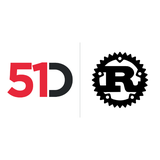

# 51Did Core

The 51Did element data, property names and metadata that any engine producing
51Dids is built on.

- `FodIdData` gives typed access to the six identifiers a 51Did result holds,
  each as the raw base64 envelope and as a parsed `FodId`.
- `FodIdDataBase` is the concrete data an engine stores under `FODID_DATA_KEY`.
- `IDENTIFIER_PROPERTIES` gives the six property names, and
  `default_fiftyone_property_metadata` and `default_component_metadata` their
  metadata, in the category and component `FODid`.

The crate depends on the pipeline core, the aspect engine layer, the
51Degrees metadata model and the `fodid` reader only, so an engine producing
51Dids can be built on it without the cloud request engine. The cloud engine
in `fiftyone-fodid-cloud` populates the same data and re-exports every item
here.

This crate is part of the [51Degrees](https://51degrees.com/?utm_source=github&utm_medium=readme&utm_campaign=51degrees-rust&utm_content=fiftyone-fodid-core-readme.md&utm_term=introduction) Rust solution for high-performance
device detection and IP intelligence, available both on-premise from a local
data file and from the 51Degrees cloud.

## License

Licensed under the European Union Public Licence v1.2 (EUPL-1.2). See the
[repository](https://github.com/51Degrees/51degrees-rust) for the full text.

## Find out more

- Source and issues: [github.com/51Degrees/51degrees-rust](https://github.com/51Degrees/51degrees-rust)
- API documentation: [docs.rs/fiftyone-fodid-core](https://docs.rs/fiftyone-fodid-core)
- 51Did: [51degrees.com/developers/51did](https://51degrees.com/developers/51did?utm_source=docs.rs&utm_medium=package&utm_campaign=51degrees-rust&utm_content=fiftyone-fodid-core-readme.md&utm_term=51did)
- 51Did documentation: [51degrees.com/documentation](https://51degrees.com/documentation/_identifiers__index.html?utm_source=docs.rs&utm_medium=package&utm_campaign=51degrees-rust&utm_content=fiftyone-fodid-core-readme.md&utm_term=documentation)
- Get a resource key: [configure.51degrees.com](https://configure.51degrees.com/?utm_source=docs.rs&utm_medium=package&utm_campaign=51degrees-rust&utm_content=fiftyone-fodid-core-readme.md&utm_term=configure)
- About 51Degrees: [51degrees.com](https://51degrees.com/?utm_source=docs.rs&utm_medium=package&utm_campaign=51degrees-rust&utm_content=fiftyone-fodid-core-readme.md&utm_term=about)
- Data files and pricing: [51degrees.com/pricing](https://51degrees.com/pricing?utm_source=docs.rs&utm_medium=package&utm_campaign=51degrees-rust&utm_content=fiftyone-fodid-core-readme.md&utm_term=pricing)
